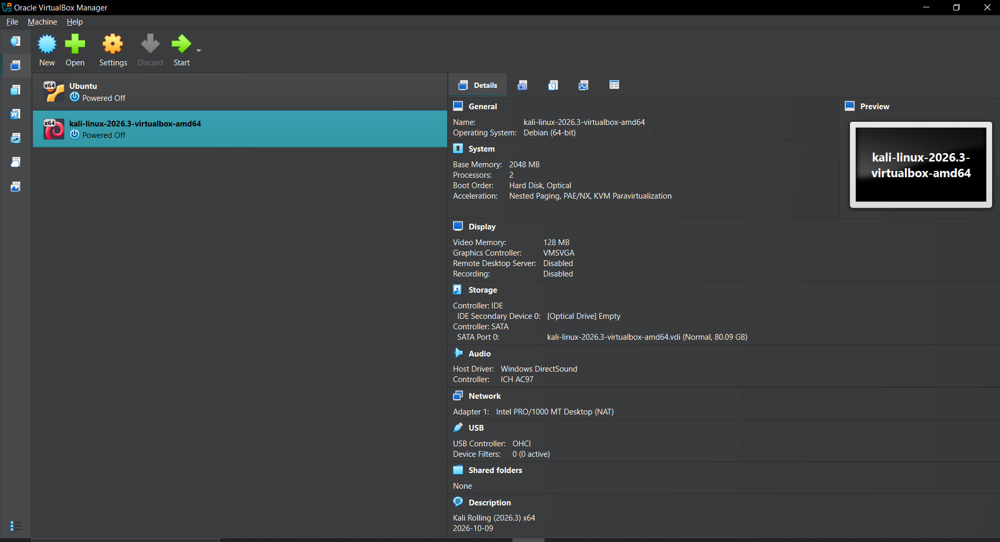
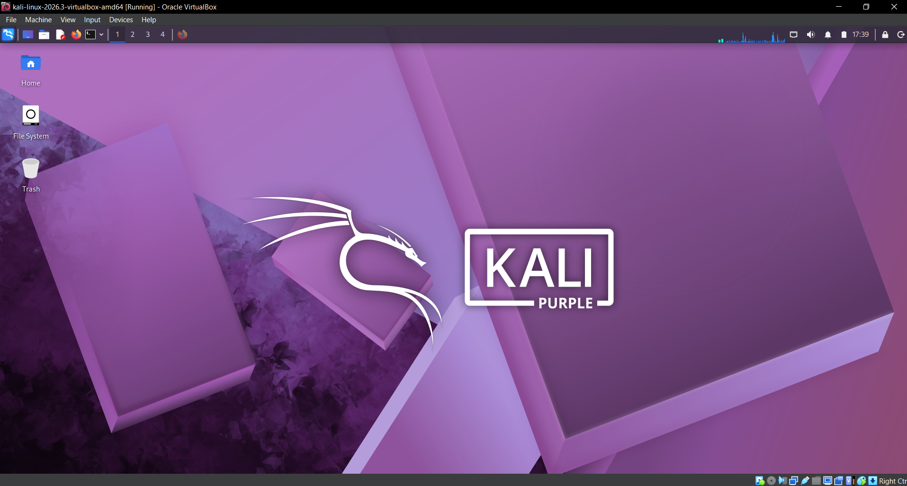
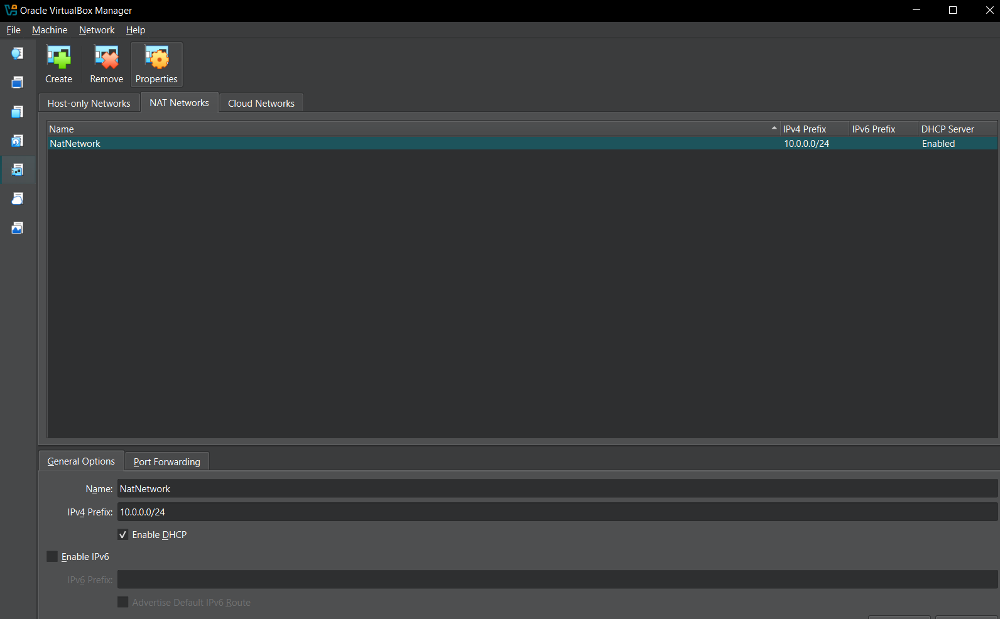

# 🔐 Cybersecurity Lab Environment Setup

**My Week 1 project: building a private virtual lab with VirtualBox and Kali Linux**


---

## 📌 Project Overview

For my first week as a Cybersecurity Intern at Networkwalks, I set up a virtual lab where I can practice cybersecurity safely. I used Oracle VirtualBox and Kali Linux.

In this project I installed and set up a virtual machine, imported a Kali Linux VM, built a private NAT Network, gave the Kali VM a fixed IPv4 address, connected it to the internet, and then tested the connection and fixed the problems I ran into.

Because the lab sits on its own private network, I can add more machines to it later and use them as targets for authorized testing.

---

## 🎯 Objectives

In this project I wanted to:

- Set up VirtualBox as my hypervisor.
- Extract and import the Kali Linux virtual machine.
- Create a private NAT Network for the lab.
- Give the Kali VM a fixed IPv4 address, gateway, and DNS server.
- Test the network connection.
- Troubleshoot and fix any connectivity problems.
- Document everything for my future projects.

---

## 🛡️ Purpose of the Lab

This lab gives me a safe, isolated place to learn and practice things like:

- Network reconnaissance
- Port scanning
- Vulnerability assessment
- Packet analysis
- Web security testing
- Trying out security tools

⚠️ **Important:** I only use this lab on systems that I own or have permission to test.

---

## 🏗️ Lab Architecture



I can add more target machines to the same virtual network in future projects.

---

## ⚙️ Lab Configuration

| 🧩 Component       | ⚙️ Configuration  |
| ------------------ | ----------------- |
| 🖥️ Host OS         | Windows 10        |
| 🧠 Host RAM        | 16 GB             |
| ⚡ Processor       | Intel Core i7     |
| 🧰 Hypervisor      | Oracle VirtualBox |
| 🐉 Guest OS        | Kali Linux 2026.3 |
| 🧠 Kali RAM        | 2048 MB           |
| 🌐 Virtual Network | NAT Network       |
| 📡 Network Address | 10.0.0.0/24       |
| 🐧 Kali IP Address | 10.0.0.2/24       |
| 🚪 Default Gateway | 10.0.0.1          |
| 🌍 DNS Server      | 8.8.8.8           |

---

# 🪜 How I Set Up the Lab

## Step 1. Get the Tools Ready

VirtualBox was already installed on my computer. I downloaded the Kali Linux virtual machine file, which came as a compressed archive, and used **7-Zip** to extract it.

**Tools used:** Oracle VirtualBox, 7-Zip

---

## Step 2. Create the NAT Network

Inside VirtualBox, I created my private network like this:

1. Went to **File** → **Network**.
2. Clicked **Create**.
3. Set the IPv4 prefix to `10.0.0.0/24`.
4. Clicked **OK**.


I chose a NAT Network because VMs on the same NAT Network can talk to each other and still reach the internet. That is what I need for a lab with several machines.

---

## Step 3. Import Kali Linux

1. In VirtualBox, I went to the **Machine** tab and clicked **Open**.
2. I found the folder where I saved the extracted Kali Linux files.
3. I selected the VM file and clicked **OK**.

Kali Linux imported successfully, and I gave it 2048 MB of RAM.



---

## Step 4. Configure the Kali Network

Next, I attached the Kali VM to my NAT Network and set a fixed IPv4 address:

- **IP address:** 10.0.0.2
- **Subnet mask:** 255.255.255.0 (/24)
- **Gateway:** 10.0.0.1
- **DNS:** 8.8.8.8

I used a fixed IP so the Kali machine is always easy to find and reference in future exercises.



---

# 🔎 Testing the Connection

After the setup, I tested the connection with these commands:

| ✅ Test                  | 🧾 Command            | 🎯 What I expected        |
| ----------------------- | --------------------- | ------------------------- |
| 🌐 Check my IP address  | `ip a`                | 10.0.0.2 shown            |
| 📡 Reach the gateway    | `ping 10.0.0.1`       | Replies received          |
| 🌍 Reach the internet   | `ping 8.8.8.8`        | Replies received          |
| 🔎 Check DNS            | `nslookup google.com` | Domain resolves           |

---

# 🐞 The Problem I Ran Into

## No network connection after setting the fixed IP

Right after I set the fixed IPv4 address, Kali had network connectivity problems and would not connect properly.

To fix it, I used the terminal. First, I checked my network details:

```bash
ip a
```

Then I turned off the duplicate address detection timeout on the connection:

```bash
sudo nmcli connection modify "Wired connection 1" ipv4.dad-timeout 0
```

Then I took the connection down and brought it back up:

```bash
sudo nmcli connection down Wired\ connection\ 1
```

```bash
sudo nmcli connection up Wired\ connection\ 1
```

Finally, I restarted the machine. After that, the connection worked.

> **Tip:** Connection names can be different on other systems. Run `nmcli connection show` first to find your own connection name.

---

# 💡 What I Learned

**1. Troubleshooting matters.** Fixing this problem showed me that troubleshooting is a big part of cybersecurity. I had to check what was wrong, try a fix, and test again.

**2. Setting up a virtual environment.** I got hands-on practice building a virtual system from scratch, from extracting the files to importing the VM and configuring it.

**3. NAT vs NAT Network.** A NAT Network lets multiple VMs connect to the same network and talk to each other, but a normal NAT does not. That is why a NAT Network is the better choice for my lab.

**4. Documentation.** I also learnt that it is important to document my work and keep logs of what I do through screenshots and other means.

---

# 🔐 Ethical Use

This lab is for education and authorized testing only.

---

# 🔗 Tools & Resources

- **7-Zip:** [https://7-zip.org/download.html](https://7-zip.org/download.html)
- **VirtualBox:** [https://virtualbox.org/wiki/Downloads](https://virtualbox.org/wiki/Downloads)
- **Kali Linux:** [https://kali.org/get-kali](https://kali.org/get-kali)

---

# 👤 Author

**Carlynda Amoah**\
Cybersecurity Professional B084

LinkedIn: [https://www.linkedin.com/in/carlynda-amoah-530779292/](https://www.linkedin.com/in/carlynda-amoah-530779292/)

---

## 📌 Project Information

**Program:** Cybersecurity at Networkwalks | **Week:** 01 | **Project:** Essentials of Cybersecurity, Cybersecurity Lab Setup | **Repository:** GitHub
